# Rapport de TP 4 — Supply chain et Policy-as-Code

**Université :** INSAT  
**Classe :** GL5  
**Année universitaire :** 2026/2027  

**Équipe :**

- Ahmed Jammoussi
- Mohamed Taher Ben Hassine
- Yassine Sallemi
- Youssef Fadhloun

---

## 1. Objectif

Le TP 4 ferme le passage qui restait après les TP 1 à 3. Les scans SAST, SCA, DAST et image détectent des vulnérabilités, mais un développeur peut encore déposer une image non signée sur le cluster, et les manifestes de départ sont trop permissifs, avec un secret en clair.

L'application est la Notes API Flask. Elle lit `API_KEY` dans l'environnement et n'expose sur `/status` que la présence de la clé et sa longueur.

Le travail se fait en quatre temps :

1. Bloquer un secret avant le commit, puis le chiffrer dans le dépôt avec SOPS et Age.
2. Faire échouer l'analyse des manifestes Kubernetes tant qu'ils ne respectent pas le durcissement demandé.
3. Produire un SBOM et signer l'image avec Cosign.
4. Imposer la signature et le durcissement à l'admission avec Kyverno (tests T3 et T4).

---

## 2. Verrouillage des secrets

### 2.1 Hook pre-commit

Gitleaks est branché en hook local via pre-commit, révision `v8.24.2`. Le hook appelle `gitleaks git --pre-commit` et charge `.gitleaks.toml`, qui étend les règles par défaut.

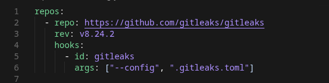

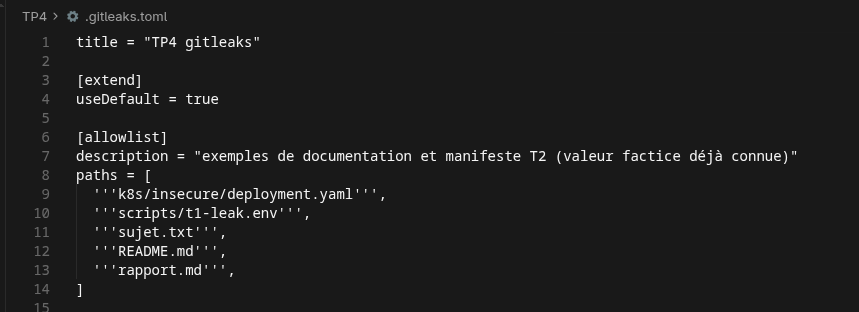

L'allowlist ne couvre que le fichier de test `scripts/t1-leak.env`, le manifeste de départ (la clé qui y figurait est révoquée) et l'énoncé. Un secret copié ailleurs n'est pas ignoré.

Le premier essai sur `.gitleaks-staging/` a affiché `no leaks found`. Ce répertoire est dans `.gitignore`, et `gitleaks detect` saute les chemins ignorés. Le même fichier, copié hors du dépôt et scanné avec le binaire du hook, produit deux fuites et le code de sortie 1.

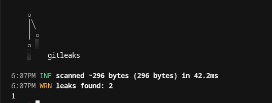

Le test T1 stage ce fichier et tente un commit. Le hook échoue avec la règle `aws-access-token` sur `.gitleaks-staging/credentials.env`. Le commit n'est pas créé.

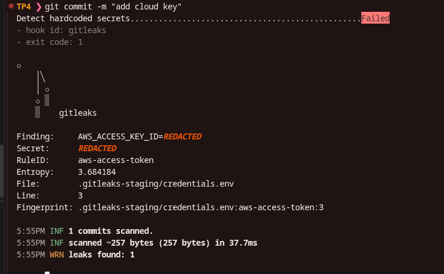

### 2.2 Secret chiffré

La clé applicative n'est plus dans le code. `age-keygen` produit une paire Age. La clé privée reste dans `age.key`, qui est gitignoré. Seule la clé publique `age1...` est écrite dans `.sops.yaml`.

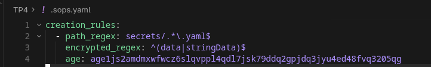

`sops --encrypt --in-place` chiffre `stringData` de `secrets/notes-api-secret.yaml`. Le champ `API_KEY` devient un bloc `ENC[AES256_GCM,...]`. Le fichier peut être commité : le déchiffrement exige `age.key`.

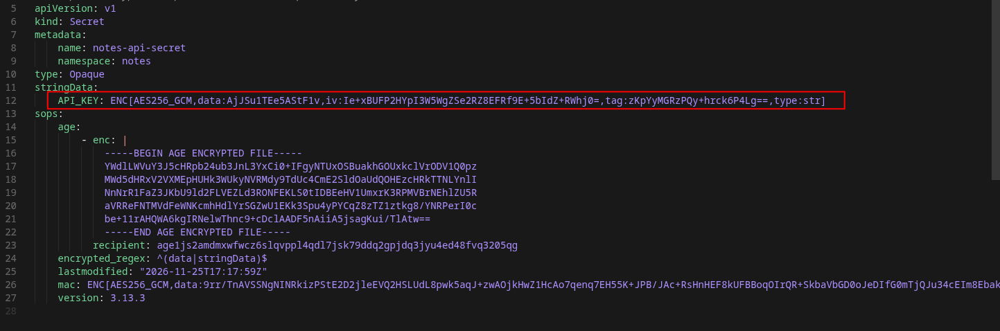

### 2.3 Job CI

Le premier job du pipeline clone tout l'historique (`fetch-depth: 0`) et lance Gitleaks. Un secret retiré dans un commit plus récent reste visible. Le job est bloquant : l'analyse IaC ne démarre que s'il passe.

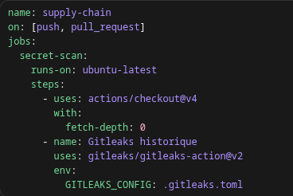

---

## 3. Manifestes Kubernetes

### 3.1 Manifeste de départ

Le déploiement fourni cumule les écarts demandés par l'énoncé : conteneur privilégié, UID 0, élévation de privilèges autorisée, tag `:latest`, et `API_KEY` écrite en clair.

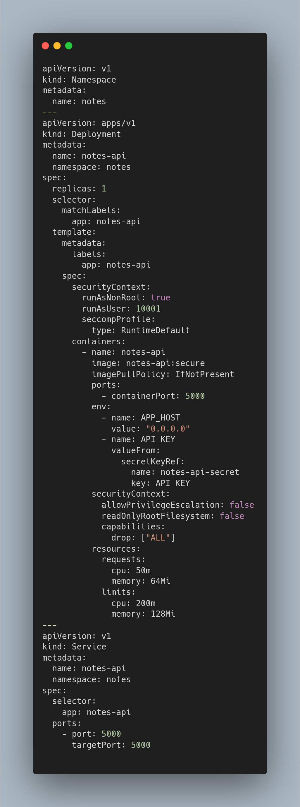

`trivy config --severity HIGH,CRITICAL --exit-code 1` s'arrête avec le code 1. Trois contrôles HIGH échouent :

| Contrôle | Constat |
| --- | --- |
| KSV-0017 | `privileged: true` |
| KSV-0118 | pas de `runAsNonRoot`, l'UID 0 est root |
| KSV-0014 | `readOnlyRootFilesystem` absent |

Le tag `:latest` et le secret en clair ne sont pas dans cette sévérité. Ils sont quand même corrigés, parce que l'énoncé les interdit et que Kyverno les refusera à l'étape 4.

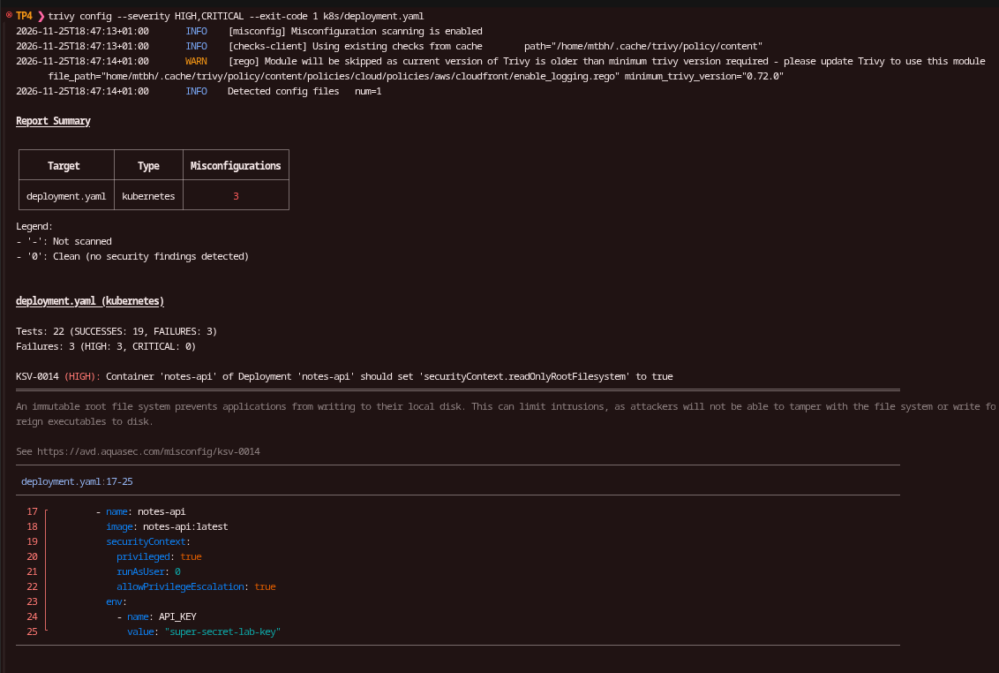

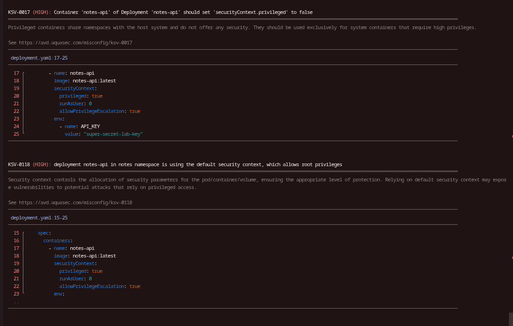

### 3.2 Manifeste durci

Le déploiement retenu impose le contexte au niveau du pod et du conteneur :

- `runAsNonRoot: true`, UID et GID `10001` (le même utilisateur que le Dockerfile), profil seccomp `RuntimeDefault` ;
- `privileged: false`, `allowPrivilegeEscalation: false`, `readOnlyRootFilesystem: true`, `capabilities.drop: ["ALL"]` ;
- requêtes et limites CPU / mémoire ;
- image `notes-api:1.0.0` à la place de `:latest` ;
- `API_KEY` injectée par `secretKeyRef` vers `notes-api-secret`, le Secret chiffré à l'étape 1.

Le système de fichiers racine est en lecture seule. L'API écrit sa base SQLite dans `/tmp`, donc ce chemin est un volume `emptyDir`.

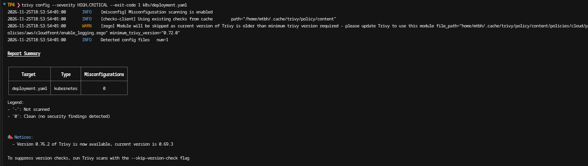

Le même scan Trivy ne remonte plus aucune misconfiguration HIGH ou CRITICAL. Le code de sortie est 0.

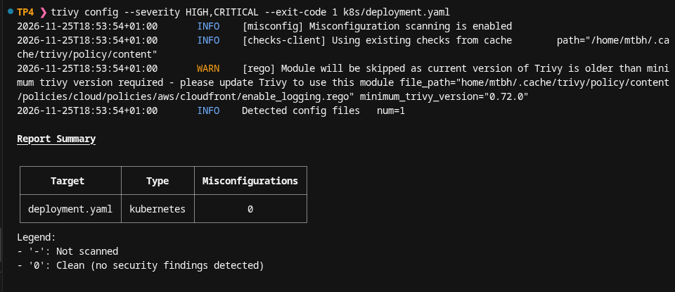

### 3.3 NetworkPolicy

Une `NetworkPolicy` sélectionne les pods `app: notes-api`. L'entrée n'accepte que le port TCP 5000, et seulement depuis des pods du même label. La sortie n'autorise que le DNS (UDP et TCP 53). Sans cette politique, le namespace laisse passer tout le trafic.

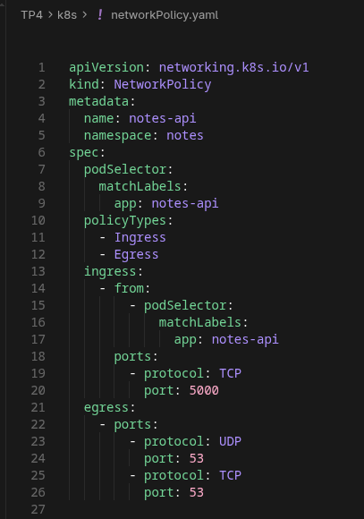

### 3.4 Job IaC

Le job `iac` dépend de `secret-scan` et lance Trivy en mode `config` sur `k8s`, sévérités HIGH et CRITICAL, `exit-code: 1`. C'est le test T2 : un manifeste repassé à `privileged: true` casse le pipeline avant toute construction d'image.

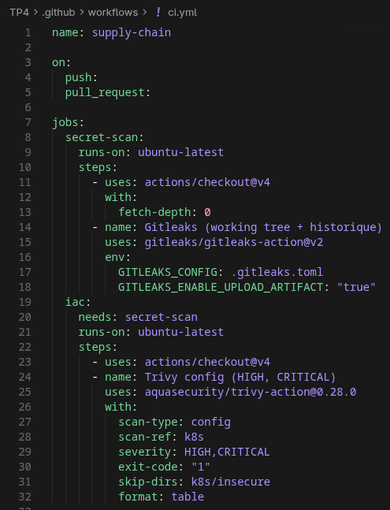

---

## 4. SBOM et signature Cosign

L'image `notes-api:1.0.0` est construite après les contrôles secrets et IaC. Syft en produit un inventaire CycloneDX 1.7 (3369 composants). Le fichier `sbom.cdx.json` est l'artefact de build.

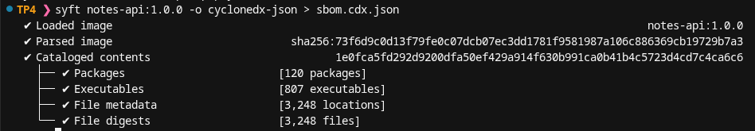

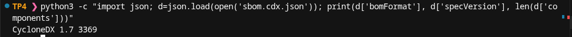

L'image est poussée sur un registre local HTTP (`host.minikube.internal:5001`), accessible depuis Minikube. Cosign 2.4 signe avec une clé asymétrique ; la clé privée reste hors Git (`cosign.key` gitignoré). La clé publique est dans `cosign.pub` et dans la ClusterPolicy Kyverno.

Le registre local n'offre pas HTTPS. La signature et la vérification passent avec `--allow-http-registry` et `--allow-insecure-registry`. Le journal de transparence Rekor est désactivé pour ce labo (`--tlog-upload=false` / `ignoreTlog: true`), faute d'instance Rekor locale.

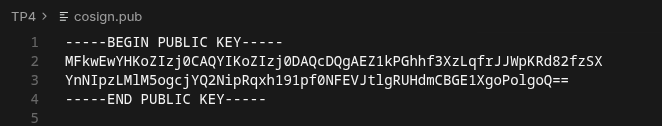

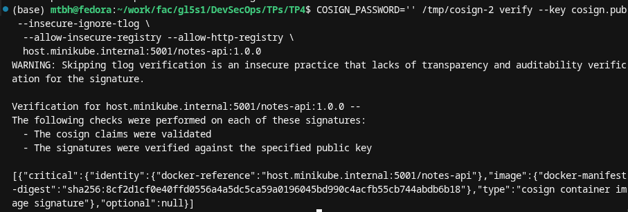

Le job CI `build-sbom-sign` enchaîne build, SBOM et signature. En CI, la clé privée et le mot de passe sont des secrets du dépôt, pas des fichiers versionnés.

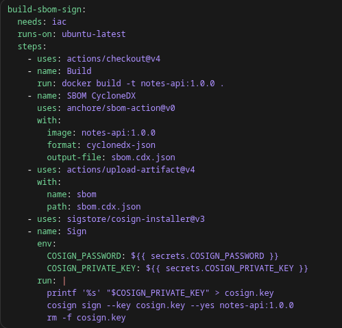

---

## 5. Policy-as-Code avec Kyverno

Le cluster local est Minikube. Kyverno est installé dans le namespace `kyverno` ; les quatre contrôleurs sont `Running`.

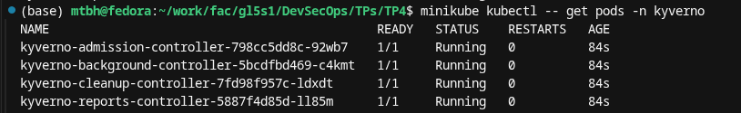

Deux ClusterPolicy en mode `Enforce` s'appliquent au namespace `notes` :

- `verify-notes-images` : toute image `host.minikube.internal:5001/notes-api:*` doit être signée avec la clé publique du pipeline ;
- `notes-pod-hardening` : non-root, pas de `privileged`, filesystem en lecture seule, `drop: ["ALL"]`, tag `:latest` interdit.

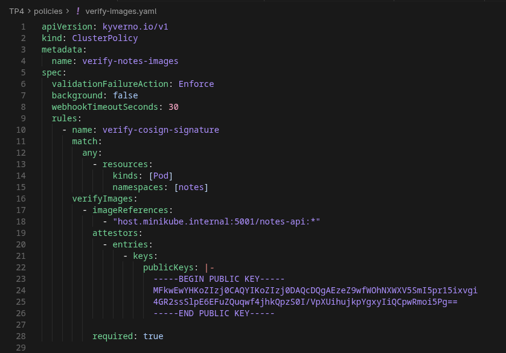

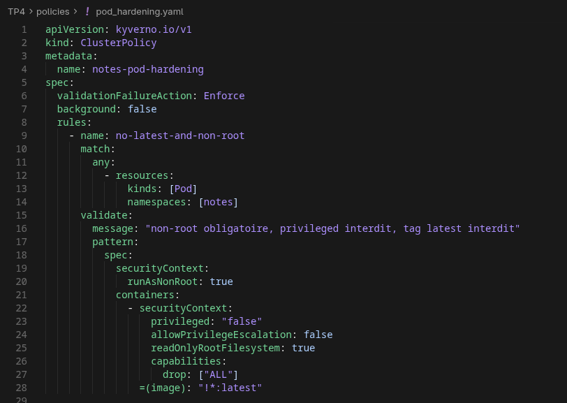

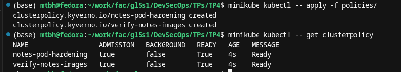

Le déploiement pointe vers l'image signée du registre local.

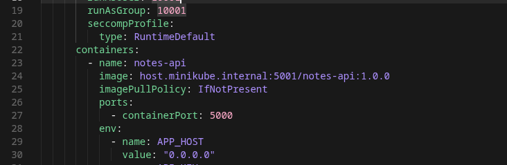

### 5.1 Test T3 — image non signée

Une deuxième image, digest distinct, est poussée sous le tag `unsigned` sans signature Cosign. Le manifeste pointe temporairement sur cette image.

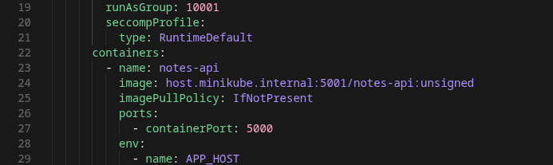

`kubectl apply` est refusé par le webhook Kyverno : `no signatures found`.

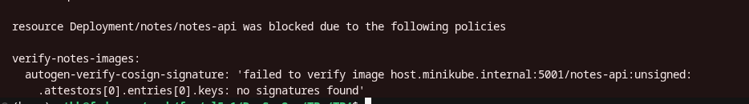

### 5.2 Test T4 — image signée

Le manifeste reprend `notes-api:1.0.0`. L'admission accepte le déploiement. Le pod passe à `Running` (`1/1`).

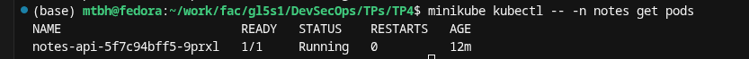

---

## 6. Synthèse

| Faible (départ) | Corrigé |
| --- | --- |
| Secret en clair / commitable | Gitleaks + SOPS/Age |
| `privileged`, root, FS inscriptible, `:latest` | Manifeste durci + NetworkPolicy + Trivy config |
| Image déployable hors CI | SBOM + Cosign + Kyverno `verifyImages` |

La clé privée Cosign ne quitte pas le poste (ou les secrets CI). Kyverno ne connaît que la clé publique. Une image construite à la main, sans cette signature, est rejetée à l'admission : le contournement du pipeline n'ouvre plus le cluster.
